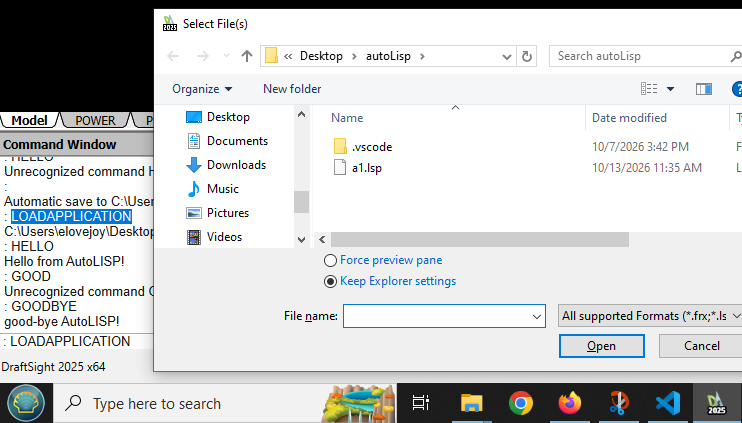

# Ojective:
learn draftsight? automate scripting of schematics.

# method: 
Im using visual studio code, for the syntax checking, and draft sight plugins. 
I dont think the scripts require this. 

setq a is equal to: var a = "stuff"
maths seem to be postscript-esque
(+(* 5 10)3) = 53

# How to draftSight:
1. with DraftSight Open, Go to the command line, and type:
LOADAPPLICATION
hit enter. A window will appear, and you then must go select the script you want to execute.

**DraftSight will not execute the script, at least as far as I know right now.**

Then you will have access to the commands present in your AutoLISP program.

```autolisp
(defun c:HELLO ()
  (princ "\nHello from AutoLISP!")
  (princ)
)

(defun c:GOODBYE ()
  (princ "\ngood-bye AutoLISP!")
  (princ)
)
```
The functions HELLO and GOODBYE are now present in the Command Line.


# resources:
<a href="https://help.solidworks.com/2024/english/api/draftsightlispreference/html/lisp_functions_alphabetically.htm">DraftSight Commands</a>  
<a href="https://help.solidworks.com/2023/english/DraftSight/html/hlpid_file_macro.htm"> Writing draftsight scripts </a>  
<a href="https://help.solidworks.com/2024/english/api/draftsightlispreference/html/lisp_functions_reference.htm">DraftSight Functions list</a>  

<a href="https://help.autodesk.com/view/OARX/2023/ENU/?guid=GUID-4CEE5072-8817-4920-8A2D-7060F5E16547">AutoLisp Function List </a>  
<a href="https://help.autodesk.com/view/OARX/2026/ENU/?guid=GUID-265AADB3-FB89-4D34-AA9D-6ADF70FF7D4B">AutoLisp developer guide </a>  
