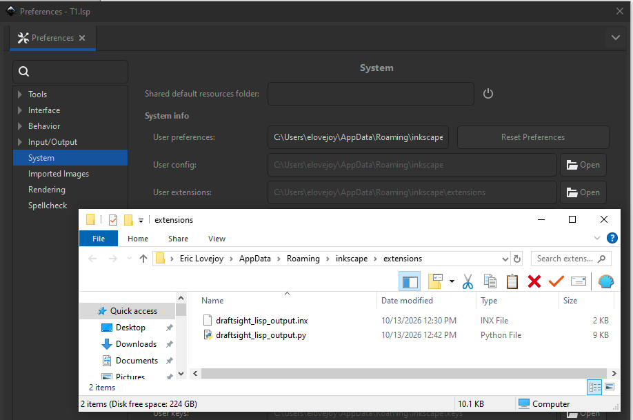

This is a plugin for inkscape.

It lets you save an svg drawn in inkscape, 
in the AutoLisp draftSight Geometry 

To install,  goto Edit -> prefferences
then under system, open the user extensions folder.
drop in    

draftsight_lisp_output.inx  
draftsight_lisp_output.py  

Close inkscape.
Then re-open inkscape.
the plug-in is now loaded. 

draw whatever. when you are done, you now have the option to save as AutoLisp *.lsp

select *.lsp 
Then you can import your drawing into draftsight by using 
: LOADAPPLICATION

# bugs?
yeah prolly its just been created. 
but it does work. 

 
